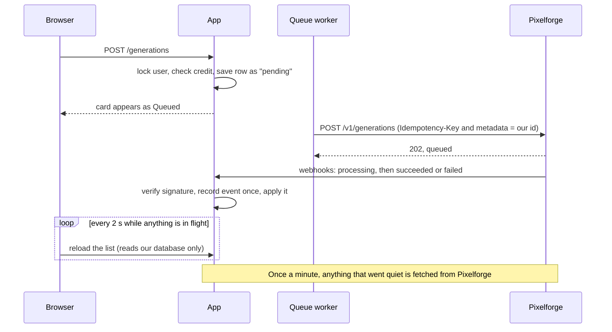

# Pixelforge Studio

A Laravel, Vue and Inertia app where signed-in users generate images through the [Pixelforge API](https://pixelforge.promptedit.dev/docs) and are charged Pixelforge's cost plus 25%. Built as the take-home assessment for the Senior Product Engineer role at PromptEdit.

- **Generate**: prompt, size, quality and optional reference images, with the price shown before submitting.
- **Pricing**: an estimate up front, the exact cost recorded when the image is done, nothing for a failure.
- **History**: every generation with live status, estimated and actual cost, and the image.
- **Webhooks**: signature-verified, safe against duplicates and reordering.
- **Balances** (stretch): buy credits, and generating is blocked when it can't be afforded.
- **Admin report** (stretch): spend, provider cost and profit per day and user, checked against `GET /v1/usage`.

## Run it locally

You need PHP 8.4+, Composer and Node 22+.

```bash
composer setup        # install, create .env, migrate (SQLite), build assets
```

Create a Pixelforge API key for this environment and put it, with its signing secret, in `.env`:

```dotenv
PIXELFORGE_API_KEY=...
PIXELFORGE_WEBHOOK_SECRET=whsec_...
```

Pixelforge has to reach the app to deliver webhooks, so expose it with a tunnel and set that key's webhook URL to `https://<tunnel-host>/webhooks/pixelforge`:

```bash
cloudflared tunnel --url http://localhost:8000
composer dev          # web server, queue worker, scheduler, logs and Vite
```

Register at http://localhost:8000, buy some credits, and generate. To see the admin report, run `php artisan app:make-admin you@example.com`.

Without a tunnel everything still works, only slower: the scheduler fetches results once a minute instead.

```bash
composer test                               # Pint, PHPStan (level 7) and the test suite
npm run check && npm run types:check        # formatting, lint and vue-tsc
```

## How a generation moves



News about a generation reaches the app three ways: the response to the create request, a webhook, or the once-a-minute poll. Each carries Pixelforge's full generation object, so all three go through one function, [`ApplyProviderSnapshot`](app/Actions/ApplyProviderSnapshot.php), with one rule: **a snapshot is applied only if it moves the generation forward** (`pending → queued → processing → succeeded | failed`). A duplicate or a late arrival finds nothing to do. That one rule is what makes duplicates, reordering and missed webhooks harmless.

## Money

**The unit is the nanodollar.** All money is a whole number of nanodollars (10⁻⁹ USD) in `bigint` columns. That is the precision Pixelforge bills in (`"0.046125000"`), so its costs fit exactly. Nothing is ever a float and nothing is rounded to cents. Amounts become decimal strings only at the edges: reading Pixelforge's JSON, and sending numbers to the browser ([`Money`](app/Billing/Money.php)).

**Actual cost.** Pixelforge returns token counts, never a price. When a generation succeeds, its cost is each token count times the rate _on that generation_ (fixed when it was created), and the user is charged that plus the markup ([`CostCalculator`](app/Billing/CostCalculator.php)). `"12.50"` per million tokens is exactly 12,500 n$ per token; a rate too fine to bill exactly is refused rather than rounded. The markup (2500 basis points) is copied onto each generation when it is requested. If cost × 1.25 were ever not a whole nanodollar it would round up; at today's rates it is always whole.

**Estimate.** Before submitting, the form shows the expected charge and the least and most it could be ([`QuoteCalculator`](app/Billing/QuoteCalculator.php)). Rates and token rules come from `GET /v1/pricing`, cached for a minute, never hardcoded. Output and reference-image tokens are exact; prompt tokens are `ceil(characters / 4)` give or take 15%; reasoning tokens are only known afterwards, so the estimate takes the middle of the documented range. The quote is computed on the server by the same code that prices the submission, so the number shown is the number recorded.

**Recorded once.** A user is charged in exactly one place: inside the database transaction that moves a generation to `succeeded`, while holding a lock on its row. The charge is a ledger entry, and `ledger_entries.generation_id` is unique, so the database itself refuses a second one. A failed generation never reaches that code and costs nothing.

**Balances.** A balance is the sum of a user's ledger entries; there is no stored balance to drift. While a generation is in flight, the most it could cost is set aside, so available credit is balance minus those holds. The check runs under a lock on the user row, which stops two simultaneous requests from spending the same credit. On success the actual cost is charged and the rest released; on failure everything is released.

**On screen.** Amounts are stored to nine decimals and shown to four. Costs round up and balances round down, so the screen never makes something look cheaper, or an account richer, than it is. Exact figures are on hover, in the details dialog and on the credits statement. The admin report shows all nine decimals.

## What Pixelforge does, and what the app does about it

| Pixelforge                                             | The app                                                                                                                                                   |
| ------------------------------------------------------ | --------------------------------------------------------------------------------------------------------------------------------------------------------- |
| A webhook can arrive before the create request returns | The row is saved before the request is sent, and events are matched by `metadata.generation_id`, our own id, which we know from the start                 |
| The same event is delivered twice                      | The event id is the primary key of `webhook_events`. A repeat finds the row and stops; only a delivery counter changes                                    |
| Events arrive out of order                             | Statuses only move forward; `succeeded` and `failed` are final                                                                                            |
| A webhook never arrives                                | A scheduled sweep fetches anything quiet for 45 seconds                                                                                                   |
| Anyone can POST to the webhook URL                     | HMAC-SHA256 over `timestamp.rawBody`, compared in constant time, rejected if older than 5 minutes                                                         |
| At most 3 generations at once                          | The submit job counts ours first and waits without calling. A `429` means wait for `Retry-After`. Waiting is not a failure; there is a 15-minute deadline |
| 60 requests a minute                                   | `Retry-After` is honoured. The page's polling never calls Pixelforge                                                                                      |
| `503 overloaded`, timeouts                             | Retried with the same idempotency key, backing off (2 s, 4 s, 8 s, never less than `Retry-After`), then given up on: failed, free                         |
| Rejected prompt, daily limit, bad request              | No retry. Failed at once, with a plain explanation                                                                                                        |
| Fails after accepting                                  | Marked failed with the reason. No charge, the hold is released                                                                                            |
| Prices change                                          | Estimates follow `GET /v1/pricing`; actual costs use the rates on the generation                                                                          |
| Image links expire after 24 hours                      | An "expired" placeholder instead of a broken image                                                                                                        |

## Decisions where the brief left room

- **Fractions of a cent are kept, not rounded.** A low-quality image can cost us as little as 1.12¢, which should cost the user 1.4¢. Rounded up to a whole cent it would cost them 2¢: a 79% markup instead of 25%. Storing exact amounts means provider cost matches Pixelforge to the last digit and the markup is exactly what it claims to be.
- **Always charge the actual cost**, even if it lands above the estimate. The estimate is information; the price is cost plus 25%. It also stays right if Pixelforge changes its rates between the quote and the generation.
- **Set aside the maximum, not the estimate.** With only the estimate held, an unlucky run of reasoning tokens could take a balance below zero.
- **Webhooks are handled in the request, not on the queue.** Applying an event is one short transaction with no outside calls. Recording the event and applying it share that transaction: if applying fails, the record rolls back and Pixelforge's own retry delivers it again. A 2xx means it really was applied.
- **Polling, not websockets, for live status.** Two seconds, only while something is in flight, reading only our database. No extra infrastructure to run or to fail.
- **Pixelforge's word beats ours.** If we give up submitting (say every attempt timed out) and Pixelforge later reports that generation after all, it is linked and settled normally. Our books can't miss a cost Pixelforge billed.
- **Cost records outlive accounts.** Deleting an account detaches its generations and ledger entries instead of deleting them, or our totals would stop matching Pixelforge's.
- **New users start with no credit** and buy packs of $5, $10 or $25. The purchase is simulated.
- **Admins are made on the server** with `php artisan app:make-admin`. Nothing in the app can set the flag.
- **No email verification.** The demo has no mailer, so a new account could never confirm its address. For the same reason password-reset emails only reach the log.
- **Images are linked, not copied.** The brief allows it; storing them is listed below.

## Where things are

| Path                                                                                   | What is there                                                                                                                          |
| -------------------------------------------------------------------------------------- | -------------------------------------------------------------------------------------------------------------------------------------- |
| [`app/Pixelforge/`](app/Pixelforge)                                                    | The API client, its error type, webhook signature check, and typed copies of Pixelforge's objects                                      |
| [`app/Billing/`](app/Billing)                                                          | Money, cost and quote arithmetic                                                                                                       |
| [`app/Actions/`](app/Actions)                                                          | `StartGeneration`, `ApplyProviderSnapshot`, `FailGeneration`, `HandleWebhookEvent`                                                     |
| [`app/Jobs/SubmitGeneration.php`](app/Jobs/SubmitGeneration.php)                       | Sends a generation to Pixelforge: waiting, retrying, giving up                                                                         |
| [`app/Console/Commands/SyncGenerations.php`](app/Console/Commands/SyncGenerations.php) | The once-a-minute sweep                                                                                                                |
| [`app/Reports/SpendReport.php`](app/Reports/SpendReport.php)                           | The admin report and its comparison with Pixelforge                                                                                    |
| [`resources/js/pages/`](resources/js/pages)                                            | The studio, the credits statement and the admin report                                                                                 |
| [`tests/`](tests)                                                                      | Unit tests pinned to the worked examples in the Pixelforge docs, and feature tests for the lifecycle, webhooks, credits and the report |

## Deploying

The app runs on Laravel Cloud with PostgreSQL. It needs three things beyond the web process, and the last two are easy to forget:

1. **A database.** Attach Postgres; the `DB_*` variables are injected.
2. **A queue worker** on the database queue (`php artisan queue:work`), as a background process on the app cluster. Without it nothing is ever submitted.
3. **The scheduler.** Without it a missed webhook is never caught up on.

Build with `composer install --no-dev`, `npm ci`, `npm run build` and `php artisan optimize`; deploy with `php artisan migrate --force`. Set `APP_KEY`, `PIXELFORGE_API_KEY` and `PIXELFORGE_WEBHOOK_SECRET`, using an API key created for production only, and point that key's webhook URL at `https://<host>/webhooks/pixelforge`.

Each environment must use its own Pixelforge key: `GET /v1/usage` is per key, so a key shared with another environment could never reconcile.

CI runs the test suite twice: on SQLite, and on PostgreSQL.

## Left out, and what I'd do next

- **Store the images.** Download each finished image to object storage in a queued job, so history outlives Pixelforge's 24 hours.
- **Push instead of poll.** Broadcast status changes over websockets once there are enough users for polling to matter.
- **A client-side limiter** for the 60 requests a minute. Today the app relies on being well under it and on honouring `Retry-After`.
- **Strict fairness.** Waiting generations retry on a timer, so order is roughly but not strictly first come, first served, and one user can fill the queue.
- **An idempotency token on the form.** The Generate button disables itself while submitting, but two tabs can still submit the same thing twice.
- **Automatic retry** of generations that fail with `internal_error`. Today the user presses Try again.
- **Real payments**, and refunds as a third kind of ledger entry.
